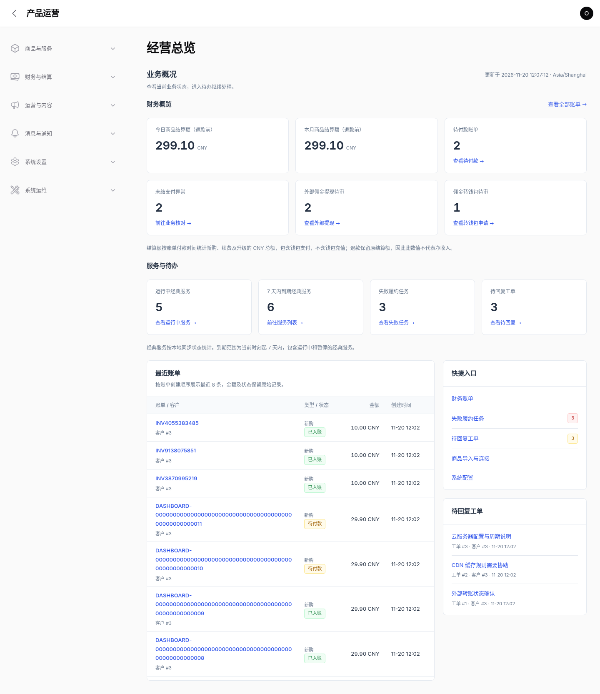

# 后台外壳与经营总览实施记录（A 批）

日期：2026-11-20。基线：`ee24c2d`。页面合同见 `admin-dashboard-ui-contract-2026-11-20.md`。

## 交付范围

本批完成 Filament 外壳统一及 `/admin` 经营总览，继续使用现有后台和组件。没有新增数据库迁移、依赖、前端框架或构建链，没有重做 B1 / B2 的旧业务页面。

| 项目 | 实施结果 |
| --- | --- |
| 面板外壳 | 主色统一为 `#2f54ea`，使用 full 内容宽度，支持 Filament 原生桌面侧栏收起；手机继续使用同一全局导航抽屉 |
| 导航 | 保留六个可折叠分类、三十个业务入口及原权限和 URL；补齐本地 Heroicons；经营总览通过左上品牌首页链接返回，不另增第三十一个业务菜单 |
| 公共样式 | `admin-shell.css` 提供共享 Token，公共组件和配置中心统一 13px 基础字号、8px 圆角、18px / 20px 卡片内边距、10px / 14px 表格单元格；保留浅色 / 深色与手机布局 |
| 经营总览 | `/admin` 成为所有已获后台准入角色的默认首页；分域指标卡、最近八条账单、最近五条待回复工单及有权限的快捷入口 |
| 权限与空态 | 没有对应权限的区块不查询、不渲染；只拥有设置等其他权限时显示其可访问入口与说明，不将无权限冒充真实零值 |

## 指标口径

今日 / 本月金额显示为“商品结算额（退款前）”，以账单为一单一笔：币种为 CNY，类型为新购 / 续费 / 升级，状态为 `Paid` 或 `Refunded`，`paid_at` 位于应用时区的本月起点至当前时刻；当天部分以当天起点切分。使用账单 `total_amount`，包含钱包与网关组合支付，不含充值、降级及未来时间的记录；退款保留原商品结算额。该指标不表示实收现金、退款后净额或利润。

数据库按单额分组，并分别统计本月 / 当天笔数；模型 `decimal:2` 单额与整数笔数经 `Money::mul/add` 累计。没有对金额列执行数据库 `SUM`，没有把 SQLite 聚合浮点数转成账款，也没有在 PHP 加载全部历史账单。原客户软删除不会通过用户关联抹掉保留账单。

| 指标 / 列表 | 精确定义 |
| --- | --- |
| 待付款账单 | `invoices.status = Unpaid` |
| 外部佣金提现待审 | `affiliate_withdrawals.destination = external` 且 `status = pending` |
| 佣金转钱包待审 | `affiliate_withdrawals.destination = wallet` 且 `status = pending`，与外部提现分列 |
| 未结支付异常 | `reconciliation_cases.kind = payment_attention`，状态为 `open` / `awaiting_clearance`；不混入旧资源换绑案件 |
| 运行中经典服务 | 经典魔方驱动且本地同步状态为 `Active`，不代表实时机器状态 |
| 七天内到期经典服务 | 同一驱动、状态为 `Active` / `Suspended`，`next_due_at` 在当前时刻至七天后之间，包含两个端点；过去及七天外排除 |
| 失败履约任务 | `fulfillment_tasks.status = failed`，不将其他终态或运行任务混入 |
| 待回复工单 | `tickets.status = open`；最近待办按 ID 倒序最多五条 |
| 最近账单 | 按 ID 倒序最多八条，使用原编号、状态、类型、金额、币种和创建时间；详情继续使用原 `invoice_id` 路由 |

## 授权、请求与历史边界

财务、经典服务、履约和客服分别先检查 `finance.view`、`upstream.view`、`tasks.view`、`support.view`，再执行该区块查询；未授权业务表不查询。查看权限不扩大为写权限，商品与连接快捷入口按原导入权限区分只读 / 可导入文字。匿名用户仍跳 `/admin/login`，普通客户与已关闭账户不能通过新增首页进入后台。

普通 GET 只读本地事实，不调用上游、支付、邮件、短信、实名、同步、重试、收款核对或应收完整证明流程。最近记录采用字段白名单，不加载订单秘密 JSON、机器凭据、提现收款资料、任务 payload 或工单回复正文；文本按 Blade 转义。

本轮用户明确要求修改默认首页并启用原生桌面收起，因此旧导航测试只作两处展示合同适配：首页严格预期改为 `/admin`；Filament 预渲染的展开列表 / 收起下拉分别检查精确三十条链接、各自唯一且不含记录路由。模型六组 / 三十入口、旧 URL、分域权限与唯一当前项的原严格断言保持；未改资金、幂等、支付或生命周期规则。

## 验收

| 验收项 | 实际结果 |
| --- | --- |
| 新增专项 | Dashboard 18 项、外壳 5 项，共 **23 项**；覆盖授权先于查询、精确大额、日期边界、退款前口径、原状态、最近记录与秘密投影 |
| 相关定向 | Dashboard 与原导航合跑 **48 passed / 611 assertions**；原导航严格检查继续通过 |
| Pest 全量 | **2,502 passed / 21,888 assertions**，日志 `/tmp/phpidc-dashboard-pest.log` |
| PHPStan / Pint | **0 errors / PASS** |
| 浏览器主矩阵 | 桌面 / 手机 × 浅色 / 深色，共 **16 组**页面检查通过 |
| 权限浏览器验证 | **6 组角色**验证通过，区块与入口按既有查看权限裁剪 |
| 桌面收起交互 | 侧栏收起为 **72px**；财务菜单显示八个唯一入口，点击账单入口与品牌返回总览通过 |
| 手机抽屉 / Escape | 390px 深色下打开导航、展开财务分类、跳转账单并自动关闭抽屉通过；Escape 关闭并返回触发点、Enter 重新打开、品牌返回总览通过，文档无横向溢出 |
| 共享预览只读检查 | `/up`、`/admin/login`、两份新增 CSS 与现有 SVG 图标均返回 200；匿名 `/admin` 返回 302 到 `/admin/login` |

验收使用隔离 SQLite、独立 storage 和隔离浏览器站点，没有执行真实支付、开通、出款或业务通知。Feature 使用 `Http::preventStrayRequests()` / `assertNothingSent()`；浏览器仍可能请求 Filament 既有的 `ui-avatars` 默认头像，本记录不将所有外网请求记为零。共享预览与实际业务数据不用于建单或资金实验。

## 截图留档

以下五张为实现提交 `a4265a6` 的原始浏览器验收截图，页面使用隔离测试库中的模拟账单、工单和金额。截图为整页截取，因此图片高度大于验收视口高度；侧栏收起图包含展开的财务分类菜单。文件合计约 898 KiB。

| 场景 | 验收视口 | 整页图片 | 文件 |
| --- | --- | --- | --- |
| 桌面浅色 | 1440 × 1000 | 1440 × 1666 | [desktop-light.png](screenshots/admin-dashboard-2026-11-20/desktop-light.png) |
| 桌面深色 | 1440 × 1000 | 1440 × 1666 | [desktop-dark.png](screenshots/admin-dashboard-2026-11-20/desktop-dark.png) |
| 手机浅色 | 390 × 844 | 390 × 3178 | [mobile-light.png](screenshots/admin-dashboard-2026-11-20/mobile-light.png) |
| 手机深色 | 390 × 844 | 390 × 3178 | [mobile-dark.png](screenshots/admin-dashboard-2026-11-20/mobile-dark.png) |
| 桌面侧栏收起 | 1440 × 1000 | 1440 × 1666 | [sidebar-collapsed.png](screenshots/admin-dashboard-2026-11-20/sidebar-collapsed.png) |

IMPLEMENTED: 后台外壳 / Token 统一、原生桌面收起、六组三十入口图标、品牌返回默认经营总览、按权限的本地指标与最近待办。
NOT DONE: B1 运营与内容旧页翻新、B2 库存 / 清算 / 运维旧页翻新。
DECISIONS: 沿用原查看权限与后台准入；退款前商品结算额使用原账单总额且不含充值；保留三十个业务入口，经营总览由品牌首页进入；零迁移、零新增构建链。
CONCERNS: 指标来自本地已记录事实，经典服务状态不是实时机器状态；退款前结算额不是净收入；本批没有新增真实供应商 / 支付 / 出款 / 通知验收，既有头像请求不属于业务接口调用。
GATES: pest 2502 passed / 21888 assertions | new cases 23 | phpstan 0 errors | pint PASS | browser matrix 16 groups | role checks 6 groups。
SPEC CASES: 0（未变）。
