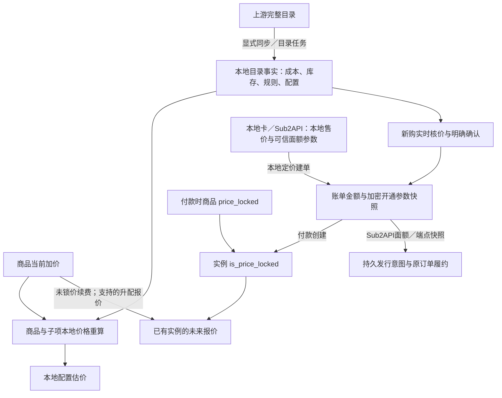

# U2 商品工作区：字段来源与生效边界清单

状态：只读源码梳理，供下一批编写实施合同使用。本文件不批准新增商品规则、写入口、权限、schema 或历史数据变更；U1 仍只实施客户／实例／账单页头与来源返回。

基线：`e400fd2`，2026-11-20；业务底座包含 C4。证据来自当前 Laravel 源码，旧后台仅作为信息组织参考。本次未运行供应商操作、支付、发卡或通知，未用旧后台 UI 推断本项目已交付能力。

## 1. 下一批可复用的现有功能

“已有字段”“已有消费者”“已有受控写 Action”“已有 Web 入口”分别判断。模型的 `$guarded = ['id']` 不构成后台字段编辑授权，见 [Product.php:20](/www/wwwroot/Laravel13idc/app/Models/Product.php:20)。

| 字段／操作 | 已交付能力与入口 | U2 可复用范围 |
| --- | --- | --- |
| `name`、`description`、`is_hidden` | [UpdateProductPresentationAction.php:14](/www/wwwroot/Laravel13idc/app/Actions/UpdateProductPresentationAction.php:14) 白名单校验，事务锁商品，记录 before/after；Web 调用要求 `cms.view + cms.edit + cms.publish`。现入口为 [CmsOperationsController.php:41](/www/wwwroot/Laravel13idc/app/Http/Controllers/CmsOperationsController.php:41) | 在商品工作区调用同一 Action，保留现有权限与审计。name 最长 255，description 必填且最长 100000。Web 备注可选，空值由服务端生成说明；不额外要求普通展示编辑填写原因 |
| 完整配置与价格同步 | [ClassicOperationsController.php:98](/www/wwwroot/Laravel13idc/app/Http/Controllers/ClassicOperationsController.php:98) 调用 `SyncClassicCatalogAction`；要求 `upstream.view` 和 `upstream.import`，显式 POST | 展示同步范围与结果，复用原 Action；详情 GET 读取本地快照，不因打开页面自动请求上游 |
| `product_option_groups.downgrade_bounds` | [ConfigureDowngradeBoundsAction.php:15](/www/wwwroot/Laravel13idc/app/Actions/ConfigureDowngradeBoundsAction.php:15) 要求 `upstream.import`，锁组、校验、审计；现入口见 [ClassicOperationsController.php:119](/www/wwwroot/Laravel13idc/app/Http/Controllers/ClassicOperationsController.php:119) | 保留“未来续费降价边界”含义；允许项须属于该可见组，数量最低值须通过现有范围／步进校验。类型 15–20、隐藏组、本地组不能开启。该操作不修改远程配置，也不重写历史账单 |
| 现有商品配置查看 | [upstream-product-detail.blade.php:1](/www/wwwroot/Laravel13idc/resources/views/filament/upstream-product-detail.blade.php:1) 已显示商品身份、连接、PID、目录版本、基础计费、加价、库存、配置子项 | 可调整为完整只读分区与周期矩阵。现有页面不能等同于完整商品参数编辑器 |

展示编辑现有表单见 [product-form.blade.php:1](/www/wwwroot/Laravel13idc/resources/views/filament/content/product-form.blade.php:1)；Web 备注默认值和 255 字符限制见 [CmsOperationsController.php:57](/www/wwwroot/Laravel13idc/app/Http/Controllers/CmsOperationsController.php:57)。降价边界中的现有 `step` 校验与新购协议中的 `qty_stage` 是不同字段，不因 UI 整理而合并或更改公式。

## 2. 上游事实：只读展示与显式同步

以下字段属于经典魔方目录协议。将它们渲染成可编辑输入框，不会自动产生可靠的本地覆盖策略。

| 来源／字段 | 当前同步行为 | 页面表达 |
| --- | --- | --- |
| `products.upstream_version`、`upstream_base_prices` | 每次完整同步更新；成本必须有匹配币种与可用价格，见 [SyncClassicCatalogAction.php:58](/www/wwwroot/Laravel13idc/app/Actions/SyncClassicCatalogAction.php:58) | 目录版本、周期成本矩阵、是否可售；明确为最近同步事实 |
| `products.local_prices` | 用本次成本和当前商品 `markup_percent` 重算，见 [SyncClassicCatalogAction.php:73](/www/wwwroot/Laravel13idc/app/Actions/SyncClassicCatalogAction.php:73) | 经典商品的本地估价矩阵，不提供独立固定销售价编辑 |
| `stock_control`、`qty` | 完整同步更新；版本不变的目录探测也可能更新库存，见 [ProbeClassicCatalogAction.php:49](/www/wwwroot/Laravel13idc/app/Actions/ProbeClassicCatalogAction.php:49) | 显示同步库存。不能将手改库存当成可靠的上游库存覆盖 |
| `provisioning_rules.classic_catalog` | 同步整块重建 version、dependencies、password、host、pay_type、已验证 publisher；见 [SyncClassicCatalogAction.php:64](/www/wwwroot/Laravel13idc/app/Actions/SyncClassicCatalogAction.php:64) | 上游生成规则、依赖、售卖方式、发布者事实只读；不允许通过 JSON 编辑绕过售卖准入 |
| 上游配置组 | 名称、类型、最小／最大值、step、单位、升配标志、排序、`upstream_meta` 与可见性均来自同步，见 [SyncClassicCatalogAction.php:90](/www/wwwroot/Laravel13idc/app/Actions/SyncClassicCatalogAction.php:90) | 展示上游／本地 ID、类型、数量约束与联动关系；暂不提供普通本地覆盖 |
| 上游配置子项 | 标签、成本、加价后价格、排序、可见性来自同步，见 [SyncClassicCatalogAction.php:108](/www/wwwroot/Laravel13idc/app/Actions/SyncClassicCatalogAction.php:108) | 可展开只读价格与父子关系；不能仅改标签或 ID 假装改变交付配置 |
| 上游自定义字段 | 名称、类型、选项、正则、必填、下单／详情可见性由同步写入，见 [SyncClassicCatalogAction.php:133](/www/wwwroot/Laravel13idc/app/Actions/SyncClassicCatalogAction.php:133) | 展示字段定义，保持凭据与历史订单字段的原隐私投影；本批不复制客户字段明文 |

完整同步先在事务外读取上游，再锁商品核对驱动、连接、PID 与版本，见 [SyncClassicCatalogAction.php:52](/www/wwwroot/Laravel13idc/app/Actions/SyncClassicCatalogAction.php:52)。消失的组、子项和自定义字段被隐藏，保留本地行；不是直接删除。现有本地与上游 ID 冲突会拒绝同步。

### 2.1 普通同步与重复导入不同

| 数据 | 普通完整同步 | 对同连接、同 PID 再次导入 |
| --- | --- | --- |
| 名称 | 保留本地名称 | 按上游名称重写 |
| `markup_percent` | 保留当前加价 | 使用本次导入参数重写 |
| 描述、人工隐藏状态 | 保留 | 现有商品保留 |
| 目录、价格、库存、配置、字段 | 按完整快照更新 | 调用同一完整快照落库逻辑 |
| 本地 `provisioning_rules` 的其他键 | 保留，仅重建 `classic_catalog` | 对已有商品同样保留 |
| 组的 `downgrade_bounds` | 不在同步更新字段中，保留 | 同样保留 |

证据：普通同步写字段见 [SyncClassicCatalogAction.php:64](/www/wwwroot/Laravel13idc/app/Actions/SyncClassicCatalogAction.php:64)；重复导入按连接／PID查找商品并重写 name、markup，见 [ImportClassicProductAction.php:48](/www/wwwroot/Laravel13idc/app/Actions/ImportClassicProductAction.php:48)。不能把“再次导入”作为无副作用的刷新按钮。

导入表单中的 `cycle` 用来验证所选周期有可用价格和明确初装费；后续同步保存全部匹配币种的可用周期，见 [ImportClassicProductAction.php:36](/www/wwwroot/Laravel13idc/app/Actions/ImportClassicProductAction.php:36)。它不是“只启用这一周期”的商品策略开关。

## 3. 本地规则：存在消费者，开放编辑前需明确合同

| 字段／规则 | 当前消费者与生效事实 | 仍需明确的编辑合同 |
| --- | --- | --- |
| `markup_percent` | 同步时对周期价与初装费分别使用 Money 加价，见 [SyncClassicCatalogAction.php:187](/www/wwwroot/Laravel13idc/app/Actions/SyncClassicCatalogAction.php:187)；现有导入可设置它 | 更新范围、权限、审计、整套本地价格原子重算与历史实例未来报价影响。单改 markup 会留下旧 `local_prices`，不能当成完整实现 |
| `price_locked` | 付款创建实例时读取当前 Product，写入实例 `is_price_locked`，见 [CreatePurchaseFulfillmentAction.php:31](/www/wwwroot/Laravel13idc/app/Actions/CreatePurchaseFulfillmentAction.php:31) | 已建单未付款期间修改开关如何生效；不能先标注为“只影响修改后的新订单” |
| `require_kyc`、`require_phone` | 建单事务核对当前商品准入与客户状态，见 [CreateComboInvoiceAction.php:95](/www/wwwroot/Laravel13idc/app/Actions/CreateComboInvoiceAction.php:95) | 白名单写 Action、权限、验证与对已确认报价／重复请求／旧账单的生效说明；不扩为全站准入策略 |
| `hostname_mode`、`hostname_regex` | `ProvisioningValidator` 按当前本地约束验证，见 [ProvisioningValidator.php:19](/www/wwwroot/Laravel13idc/app/Support/ProvisioningValidator.php:19) | 允许的模式和值、正则有效性、与上游规则兼容及失败反馈 |
| `hostname_prefix` | 自动生成时与上游前缀和长度求兼容，冲突会拒绝生成，见 [GenerateProductProvisioningDefaultsAction.php:36](/www/wwwroot/Laravel13idc/app/Actions/GenerateProductProvisioningDefaultsAction.php:36) | 允许字符／长度及生成可用性验证；不覆盖上游 `classic_catalog.host` |
| `password_min_len`、`password_max_len`、`password_regex` | 本地验证与默认生成均使用；生成还受上游字符类、长度约束，见 [ProvisioningValidator.php:28](/www/wwwroot/Laravel13idc/app/Support/ProvisioningValidator.php:28)、[GenerateProductProvisioningDefaultsAction.php:72](/www/wwwroot/Laravel13idc/app/Actions/GenerateProductProvisioningDefaultsAction.php:72) | 范围、兼容验证与开通参数快照边界；不把真实开通密码当商品配置保存或自动回显 |
| 本地卡商品 `local_prices.onetime` | 已有 [CreateLocalCardProductAction.php:17](/www/wwwroot/Laravel13idc/app/Actions/CreateLocalCardProductAction.php:17) 创建能力，驱动为本地价格权威 | 现有创建 Action 使用 system 审计，没有等价的 Web 更新 Action；不能直接变为任意商品编辑接口 |
| Sub2API 远程卡售价与 `sub2api_face_value` | 已有 [CreateSub2ApiProductAction.php:19](/www/wwwroot/Laravel13idc/app/Actions/CreateSub2ApiProductAction.php:19) 创建整数面额 SKU；现有订单有面额／端点快照 | 新增受控更新能力时保留快照与连接不可原地换站规则；不改变已建单的发行承诺 |

### 3.1 加价会影响已有实例的未来交易

未锁价经典实例续费使用“新上游成本 + 当前商品加价”；锁价实例续费使用实例 `recurring_amount`，见 [ZjmfLifecycleProtocol.php:32](/www/wwwroot/Laravel13idc/app/Drivers/Upstream/ZjmfLifecycleProtocol.php:32)。升配报价也调用当前商品加价，见 [ZjmfLifecycleProtocol.php:65](/www/wwwroot/Laravel13idc/app/Drivers/Upstream/ZjmfLifecycleProtocol.php:65) 和 [ZjmfLifecycleProtocol.php:113](/www/wwwroot/Laravel13idc/app/Drivers/Upstream/ZjmfLifecycleProtocol.php:113)。该升配路径不因实例锁价而改用旧加价。

因此，改变商品 markup 不会重写已落库账单金额，却可能改变已有实例下一笔续费或升配报价。编辑合同必须将这两层分开，不能笼统写“历史完全不受影响”。

### 3.2 锁价标记在付款创建实例时读取

新购账单已经冻结金额、名称、驱动、连接、周期、主机名和加密开通参数，见 [CreateComboInvoiceAction.php:130](/www/wwwroot/Laravel13idc/app/Actions/CreateComboInvoiceAction.php:130)。其中没有 `price_locked` 快照。

付款创建实例时，名称、驱动、连接、周期、续费基准等优先取 purchase 快照，但 `is_price_locked` 取当时的 `product.price_locked`，见 [CreatePurchaseFulfillmentAction.php:34](/www/wwwroot/Laravel13idc/app/Actions/CreatePurchaseFulfillmentAction.php:34)。该事实不说明必须改变现行实现，只说明开放后台开关前需要明确其对在途账单的语义；更改为建单快照是另一项合同决定。

### 3.3 Sub2API 历史发行承诺已经冻结

`Sub2ApiRemoteDriver::validateParams()` 从商品读取面额和当前连接端点，进入可信参数，见 [Sub2ApiRemoteDriver.php:18](/www/wwwroot/Laravel13idc/app/Drivers/SelfHosted/Sub2ApiRemoteDriver.php:18)。建单把它们存入 `purchase.encrypted_params`；付款后复制为任务的 `encrypted_purchase`，见 [CreatePurchaseFulfillmentAction.php:50](/www/wwwroot/Laravel13idc/app/Actions/CreatePurchaseFulfillmentAction.php:50)。

发行意图从原加密快照取面额和端点，见 [ProvisionRemoteCardAction.php:41](/www/wwwroot/Laravel13idc/app/Actions/ProvisionRemoteCardAction.php:41)。之后发卡使用已提交的意图，不重新读取商品面额。既有回归 [Sub2ApiRemoteSalesTest.php:76](/www/wwwroot/Laravel13idc/tests/Feature/Sub2ApiRemoteSalesTest.php:76) 覆盖了商品后改面额仍发行原金额；本次只核对该测试源码，没有重新执行它。

## 4. 有字段但未找到实现的项目

检索范围：`app / database / routes / resources / tests`。以下“未找到”描述当前源码消费者，不代表数据库列无价值，也不批准删除它们。

| 字段 | 当前证据 | U2 处理 |
| --- | --- | --- |
| `send_welcome_email` | [核心迁移:111](/www/wwwroot/Laravel13idc/database/migrations/2026_11_16_000001_create_cloud_cms_core_tables.php:111) 建列、[Product.php:37](/www/wwwroot/Laravel13idc/app/Models/Product.php:37) cast；未找到根据该字段决定通知的业务读取 | 不显示为已生效的欢迎邮件开关 |
| `welcome_email_template_id` | [核心迁移:114](/www/wwwroot/Laravel13idc/database/migrations/2026_11_16_000001_create_cloud_cms_core_tables.php:114) 建列；未找到商品欢迎模板绑定消费者 | 不绘制可保存且声称有效的模板选择器 |
| `max_qty_per_user` | [核心迁移:110](/www/wwwroot/Laravel13idc/database/migrations/2026_11_16_000001_create_cloud_cms_core_tables.php:110) 建列；未找到限购计数／并发执行路径 | 不把有列当作限购能力已交付 |
| `price_rounding` | [核心迁移:116](/www/wwwroot/Laravel13idc/database/migrations/2026_11_16_000001_create_cloud_cms_core_tables.php:116) 默认 `two_decimals`；未找到按该字段切换算法的消费者 | 继续遵守现有 Money 舍入规则，不提供未实现的算法下拉 |

## 5. 字段来源与生效关系

图只表达上述代码的关系：经典商品的本地价格是估价，实际结账继续按实时核价与确认链路；Sub2API 为另一驱动的本地定价／快照履约路径，不是经典商品核价流程的附属步骤。估价返回 `estimate=true`、`source=local_catalog` 的证据见 [QuoteLocalProductAction.php:80](/www/wwwroot/Laravel13idc/app/Actions/QuoteLocalProductAction.php:80)。

## 6. 建议的 U2 最小范围与后续决定

下一批合同优先写清以下范围：复用商品展示编辑；增加只读周期价格矩阵、目录／配置／字段／生成规则分区；复用显式同步；复用原未来续费降价边界。维持六组全局左侧导航，不增加页内模块侧栏或分类菜单；从既有商品列表进入固定商品工作区，区块名称描述当前可用能力。

加价、锁价、准入和本地生成规则编辑，以及本地卡／远程卡完整编辑，先确定字段白名单、角色、校验、生效时点及回归，再另行实施。`category_id / slug / driver_type / upstream_api_id / upstream_pid / currency` 不因为出现在商品表而成为本轮可编辑项；本清单没有批准商品换驱动、原地换站或历史商业事实覆盖。

历史账单金额与加密参数、已发行卡、已提交发行意图、已有实例归属／到期／续费基准及绑定，仍由各自既有协议管理。商品工作区不能绕过原流程更新这些事实。新增／改变 schema 或冻结合同仍遵循 [agent-guardrails.md §1.3](/www/wwwroot/Laravel13idc/docs/agent-guardrails.md:60)。

文档校核仅包括源码定位、字段消费者检索与文件链接检查。本清单不是 U2 已实现／已验收记录，也没有执行迁移或预览赋权。
