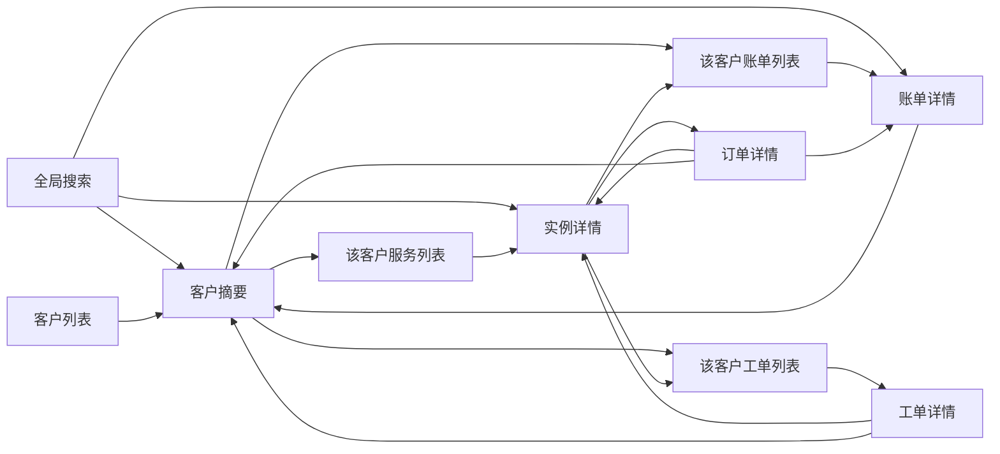

# 经典魔方后台 UI 与页面层级分析

日期：2026-11-20。分析对象：`/www/wwwroot/zjmf-manger-decoded/public/admin`。对照项目：phpidc `e7f6382`（C4 完成后）。

旧项目根 `version` 为 **3.7.7 自维护分支**，仓库文档注明基于 3.5.8 解密源码；以下分析针对当前磁盘资源，不将其泛称为所有魔方版本的设计。

## 1. 结论与证据范围

旧后台的主要价值是**围绕业务对象连续处理问题**：客户摘要提供关系入口，实例、订单、账单、工单各自有工作台，关联对象可以直接打开。视觉密度、快捷操作和上下文连续性共同形成了熟练客服的使用效率。

这套设计有三个不能混为一谈的结构：

1. **权限菜单树**决定管理员看见哪些入口和分类。
2. **Vue 路由树**决定哪些容器包住哪些页面。
3. **业务对象关系图**决定客户、实例、账单、订单、工单之间如何跳转。

实际桌面导航是“顶部业务域 → 当前域左侧菜单 → 对象内部导航 → 局部操作”。这与用户已确定的 phpidc **全局菜单全部左置、分类可收起、不再出现页内模块侧栏或分类菜单**不同。应吸收其对象关系和处理顺序，保留 phpidc 当前六组全左侧导航。

| 分析项目 | 结果 | 证据范围 |
| --- | --- | --- |
| 外壳、路由、权限菜单来源 | 已核对 | 编译 JS/CSS、登录与菜单生成代码、权限种子 SQL |
| 客户、实例、商品、连接、订单、账单、工单、插件页面结构 | 已核对 | render、data、methods、跳转参数；关键后端路由交叉核对 |
| 原始资源的桌面／手机布局 | 已观察 | 隔离静态服务器 + 模拟菜单／语言／空客户列表，1440×1000、390×844；[五张截图及说明](screenshots/legacy-admin-ui-analysis-2026-11-20/README.md) |
| 旧站实时菜单、真实业务数据、真实写操作 | 未验证 | 未登录旧业务后台，未访问旧库，未向真实对端发请求 |
| 真实首屏耗时、上游延迟、并发容量 | 未测量 | 本文只指出静态加载／轮询路径，不以资源数量推算实际耗时 |
| phpidc 改版 | 本次未实施 | 对照当前代码提出下一步顺序，不改变权限、资金规则或数据库 |

浏览器模拟菜单只有五个业务域，用来观察外壳，不代表旧系统全部菜单。完整源码清单见[路由与菜单附录](legacy-admin-ui-route-menu-inventory-2026-11-20.md)。

## 2. 外壳的真实结构

### 2.1 先分清两套后台资源

- `public/admin/index.html`、`js/`、`css/`：Vue 单页后台主体，使用 Element UI 组件与按路由加载的 chunk。
- `public/admin/themes/default/*.tpl`：插件相关页面的 Bootstrap/jQuery 外壳，具有自己的 header、menu 与 footer。
- SPA 对插件入口使用 `location.href` 整页跳转。不能用 `themes/default/menu.tpl` 代替对 SPA 菜单的分析，也不能认为所有插件页都沿用同一套 Vue 外壳。

### 2.2 桌面布局

| 区域 | 源码／模拟浏览器观察 | 设计作用 |
| --- | --- | --- |
| 顶部 | 60px 高蓝栏；Logo 区宽 200px；主色 `#2e53e9`，激活色含 `#2f54ea` | 选择主业务域，提供快速搜索、语言与管理员操作 |
| 左侧 | 宽 200px，内容取当前主域的 `list`，可展开分类并整体折叠 | 把当前域的功能集中展示，而非始终铺开所有模块 |
| 主区 | 灰底 `#eceff4`；常规内边距 `25px 20px`；主体常套一张白色 `el-card` | 用统一容器容纳高密度表格与表单 |
| 底部 | 系统版权；主区有返回顶部 | 保留品牌与长页导航 |

`Home` 有 `noCardPage` 白名单：总览、应用商店、工单详情等可以独立铺版。因此“全部详情必须套一个通用大白卡”并不是旧系统的设计原则。

在这次 1440px 模拟列表中，DOM 实测顶栏 60px、侧栏 200px、主区 1240px、表格字体 12px、表头高度 34px。不能从全局 `body` 字体或某条 CSS 直接得出所有组件均为同一字号。

### 2.3 响应式与导航取舍

- 主导航在宽度小于 1298px 时切换移动菜单；英文模式在小于 1620px 时提前切换。
- 上下文侧栏只在宽度至少 1170px 且相关状态允许时渲染。
- 手机把顶部主域与子菜单收进抽屉；并非继续同时展示三条导航。
- 390px 空列表样本中，页面本身宽 390px，表格可视区约 307px、表头内容宽 1025px。整体未横向撑破页面，但需要大量表内横滑。

旧后台明显优先照顾桌面熟练操作。手机端“能收起导航”不等于“信息密度已经针对手机优化”；不宜照搬其多列密表和固定尺寸新窗口。

### 2.4 没有发现的通用设施

`Home` 主外壳的 render 未发现统一面包屑、浏览器式多开页签栏或 `keep-alive`。常规 `router-view` 包在 transition 中并以 `$route.fullPath` 为 key。页面自己的 Tabs 与“多开页面标签”是不同概念。

## 3. 菜单树与路由树

### 3.1 主菜单来自权限，而不是编译路由列表

链路如下：

```text
AdminUserModel::get_rule()
  → role_user / auth_access / auth_rule，筛选 is_display=1
  → getTree() 按 pid 生成 list
  → PublicController 登录返回 data.rule
  → Login 保存 menuList / userInfo / token
  → Home 顶部显示 menuList，左侧显示所选域的 list
```

`activeNav`、`navIndex`、`showAside` 与 Vuex `subMenu` 协调激活和折叠。前端登录标记判断只是页面导航条件，实际业务授权不能据此省略服务端校验。

权限种子中有 1019 条规则，151 条标记 `is_display=1`；其中 143 条可沿显示父节点从八个根入口抵达，另八条缺少同样标记显示的父节点。**这些数字不是实时菜单数，也不是独立页面数。** 种子中还含分类、历史项、接口规则与外链。八条孤立项也不是额外八个顶级菜单或已证实的 404：菜单生成中会临时提升它们，再因没有 `list` 剔除；附录将它们单列。

### 3.2 菜单主干

| 主域 | 下级组织 | 使用意图 |
| --- | --- | --- |
| 客户 | 客户管理、我的业绩、运营管理 | 找客户、查实名／资源池、跟进与推广 |
| 业务 | 产品／续费／流量包订单，业务列表，暂停请求 | 订单审核与已售服务运营 |
| 财务 | 交易流水、账单、信用额、提现、发票与合同 | 收款、核账与财务处理 |
| 工单 | 工单列表、工单统计 | 客服处理与效率统计 |
| 功能 | 插件、统计、系统状态 | 扩展能力、报表与运行状态 |
| 设置 | 基础设置、系统设置、商品设置、站务设置；其下继续分类 | 高频业务入口与低频配置分开，但层级偏深 |
| 资源与商店 | 国际资源、上下游、应用商店 | 供应商、代理商品、已售产品、任务与应用 |
| 反馈 | 需求、互助、BUG 外链 | 产品社区与反馈 |

设置域的深度最明显，例如：设置 → 系统设置 → 短信邮件设置 → 接口设置。当前项目不应为模仿魔方重新引入这种层层分类。

### 3.3 Vue 路由的物理结构

编译路由数组共 229 条定义，根 Home 下面有 179 条直接子路由；有 children 的容器共六个：

| 路由容器 | 直接子路由数 | 内容 |
| --- | ---: | --- |
| `/` | 179 | Home 主壳下的业务页与其他容器 |
| `/customer-view` | 19 | 客户内各类内容，含实例详情与旧摘要 |
| `/general-settings` | 13 | 配置子页面 |
| `/app-store` | 4 | 应用详情、列表、排名、我的应用 |
| `/sms-template` | 2 | 短信／邮件接口页 |
| `/plug-management` | 1 | 插件导出页 |

`edit-product`、`configure-edit`、`order-detail`、`bill-detail`、`support-ticket-detail` 都直接挂在 Home。它们没有通过路由嵌套完整表达业务归属，而是靠 query、客户容器、页面导航和菜单激活补齐。

## 4. 页面之间是业务关系图



| 来源 | 目标路由 | 关键参数 |
| --- | --- | --- |
| 客户列表姓名／ID | `/customer-view/abstract` | `id=客户ID` |
| 客户服务列表 | `/customer-view/product-innerpage` | `id=客户ID&hid=实例ID` |
| 客户摘要“查询订单” | `/order-list` | `uid=客户ID&username=姓名`，目标展开对应筛选 |
| 客户摘要“新增订单” | `/add-order` | `uid`、`username`，另有状态存储 |
| 客户账单／订单详情账单 | `/bill-detail` | `id=账单ID&uid=客户ID` |
| 客户工单 | `/support-ticket-detail` | `id=内部ID&tid=展示号` |
| 客户创建工单 | `/add-support-ticket` | `uid=客户ID` |
| 订单项目／工单关联服务 | `/customer-view/product-innerpage` | `id`、`hid` |
| 账单详情客户名 | `/customer-view/abstract` | `id=客户ID` |

路径以 Vue 内部路径表示，浏览器部署时一般在后台目录的 `#/…` 之后；这些不是可直接套用到 phpidc 的 Laravel 路由。

重要差异：实例里的“查流水／账单／工单”会先请求实例关联数据，存到 Vuex，再跳客户子页；URL 只保留客户 ID。这种连续操作很方便，但主机筛选并不完整体现在地址里。新项目应让目标页真实支持并校验 `user_id`、`instance_id` 等显式过滤，不能只拼一个不被后端读取的参数。

## 5. 客户工作区

### 5.1 客户容器保留“正在处理谁”

`CustomerView` 桌面使用水平 `el-menu`，窄屏切换 `el-tabs`；候选入口共 14 项：摘要、开发者资料、个人资料、产品服务、账单、交易记录、信用额、工单、日志、API 概览、通知日志、附件、推广计划、跟进状态。开发者、版本、推广资格影响实际显示。

每次切页保留客户 ID，`Flag` 持续显示 ID／姓名／公司，长内容有 tooltip。这是对象身份提示，作用是减少客服在多个客户间操作时的混淆。

但 14 个候选入口很密集。phpidc 当前已用概要、页内锚点与区块直达实现客户关联，不必复制这条横向菜单，更不应为客户详情新增内部侧栏。

### 5.2 摘要采用身份与业务分区

新版 `CustomerAbstract` 桌面左列占 5/24，右列占 19/24；手机变单列。

- 身份区：联系资料、实名、来源、备注、账号操作。
- 工单区：总数、处理中、已回复、已关闭，点击进入该客户工单。
- 财务区：收支、未付款、到期服务、余额及条件信用额，数值可直达相关明细。
- 产品区：按业务类型区分服务数量及状态，提供查订单／新建订单。

它的摘要是“少量可行动的统计 → 对应明细”，并非把所有明细表一次展开。当前客户页已经有完整聚合，下一步可调整首屏主次和摘要直达，不需重做 C1。

### 5.3 客户列表的密度

ID／姓名／联系方式／服务数／收支／余额／客户分组／状态／销售／信用额等同屏；姓名和服务数可点击，次要信息放第二行或 tooltip。高级筛选默认收起，需要时展开；分页可选 10～100，默认通常 50。

值得借鉴的是“主信息可直达、次要信息不抢列宽”。不建议原样搬入所有列；当前项目的可用、账单冻结、结清冻结有不同含义，不能为缩列合成含义不清的余额。

## 6. 实例、商品与连接工作台

### 6.1 实例：运维与商业事实就近组织

实例路径嵌在客户下，顶部可以切换该客户其他主机。主体是产品、财务、配置、自定义字段四块纵向区域，而非四条全局菜单。

| 区块 | 旧系统的信息与动作 | 对当前项目的启示 |
| --- | --- | --- |
| 产品 | 服务器、IP、账号、主机名、上游ID、订单；工单／消息／转移入口 | 首屏持续明确实例与客户归属，关联对象就近可点 |
| 财务 | 首次金额、续费金额、周期、到期、状态、优惠、上游成本；账单／流水 | 财务事实集中，展示权限仍按模块裁剪 |
| 配置 | 配置值与“应用至接口” | 本地配置与远程应用的生效范围需要清楚分开 |
| 动作 | 模块能力按钮、重装／救援等弹窗、保存／取消／删除 | 按能力展示操作，破坏性操作独立确认 |

当前 C4 已有实例工作台、实际管理员身份的机器操作、显式同步和失败任务重试，不能再列为缺失。后续可加强页头、实例切换和返回来源，但不因此引入尚未批准的到期日修改、改续费价、过户。

### 6.2 商品：售卖对象的完整配置工作区

`EditProduct` 有十个对象配置页签：详情、定价、试用、自动开通、产品配置、升级选项、自定义字段、商品推介、下载、商品链接。

设计的重点是把同一商品的售卖要素集中：主机名／密码生成规则、库存、可见性、准入、计费周期与价格、驱动和配置关联。定价用“周期 × 初装费／价格／启用”的矩阵表达，而不是十几个互不相干的全局页面。

字段旁提供邮件模板、服务器、上游连接等相关设置的快捷链接。复杂配置编辑则进入独立编辑器，并携带商品／配置组／配置项 ID。

当前 `/admin/upstreams?product=…` 仍主要是已导入商品与配置事实的查看／管理入口；要建设完整可配置参数工作区，应先列明哪些字段允许本地修改、哪些来自上游、哪些修改影响下一次报价。UI 不能先画出保存按钮，再倒推业务能力。

旧版商品配置使用新窗口并每 500ms 检测关闭；十个 pane 未显式标记 lazy，初始化还取多类列表。应借鉴完整配置结构，采用明确 URL 与按需读取，避免窗口轮询与首屏全加载。

### 6.3 上游连接：一个连接下串联目录与履约

`ConfigureEdit` 集中概览、商品、产品、服务器（仅 manual）、任务、订单，内容按当前选择条件挂载。连接不只是密钥表单，也是目录与交付状态的聚合入口。

这适合改进当前“连接 → 导入目录 → 已导入商品 → 已售实例 → 任务”的直达链。应把连接 ID 明确放进 URL；不复制 `overview_query` 通用 sessionStorage 依赖，也不改变 Sub2API 禁止原地换站等既有约束。

## 7. 订单与账单各有分工

### 7.1 两种列表的顶部切换不同

- `OrderList`：全部／待审核／已激活／已取消，属于**订单状态过滤**。
- `BillManagement`：全部／充值／产品／续费／信用额，属于**账单业务类型过滤**，不是付款状态。
- 高级筛选再处理客户、金额、日期、支付方式等维度。
- 列表底部有选中数量／金额、本页合计及批量操作。视觉上高效，但旧系统允许的直接改付款状态、删除交易等能力不应直接迁入当前资金状态机。

### 7.2 订单详情关注审核与履约

顶部对照客户、订单号、账单、优惠、IP、金额与状态；下面是订单项目和开通信息，底部为审核／取消等动作。客户、账单、实例均是可点击关联对象。

phpidc 当前账单／任务关系与旧版多商品订单模型不同。可以借鉴信息组织，不需要为 UI 对齐新增独立订单表或合并账单能力。

### 7.3 账单详情没有页面 Tabs

实际按四段纵向排列：账单信息 → 交易明细 → 账单项目 → 操作日志。状态在上方醒目显示；邮件、手动入账、退款、余额／信用额支付采用动作弹窗。

这说明好的工作台并不一定依赖更多 Tabs。当前 C3 已有原支付计划、实际收款、线下凭证、流水与履约任务，表达的资金事实比旧版更严格。改进方向是把“当前状态／应处理的下一步”前置，保留原付款计划与实际收款来源的区别。

旧版 `goList()` 使用 `router.back()`；这不保证直接打开详情后能准确回到来源列表。当前应统一明确返回目标并保留白名单筛选，不能只模仿浏览器后退。

## 8. 工单工作台与插件配置

### 8.1 工单围绕处理动作组织

独立 `SupportTicketDetail` 分三层：

1. 顶部：部门、展示工单号与标题、状态、负责人、接单／转单、最近回复时间。
2. 当前处理：回复、内部备注、选项编辑、关联产品；对客回复与内部备注分开提交。
3. 历史事实：关联服务表和会话流；按回复／备注／日志区分作者、时间、附件与颜色。

客户与服务直接链接回对应工作台。先展示要处理的动作，再展示历史，比把回复框附在长列表底部更适合连续客服处理。

当前 `/admin/support?edit=…` 仍是在列表页选中会话，不是完整独立工单页。可先做独立只读／既有回复工作台和来源保持；内部备注、责任人、转交属于后续功能设计，不能凭 UI 报告宣称已实现。

### 8.2 支付、邮件、短信按插件能力组织

支付插件列表展示标识、作者、版本、安装／启停状态、配置与排序。配置弹窗从元数据生成字段；禁用／卸载时还可选择替代支付接口。

邮件／短信同样区分接口、默认供应商、模板与发送策略。`SmsSendSettings` 的国内／国际范围是策略维度，不等于新增全局业务域。

应保留当前“易支付是支付插件”“邮件与短信同类互斥启用”“密钥不回显且留空保留”的规则。旧 UI 支持多个可安装接口，并不能证明服务端强制只启用一个供应商。

需特别避免误判：

- `generalSettings` 虽残留 route map／activeIndex，实际 render 只有标题和 `router-view`，不能认定有八个可见内部 Tab。
- `SmsTemplate` 确实渲染“短信设置／邮件设置”横向模块菜单；当前不应复制。
- 工单 `optionsTab` 的语言包文案含“导出选项”，但实际 pane 编辑工单字段，不能只凭文案判定功能。

## 9. 交互规范中可复用的部分

| 模式 | 旧系统做法 | 当前项目适合采用的口径 |
| --- | --- | --- |
| 身份 | 客户 Flag、实例选择器、账单状态 | 统一对象页头：名称、ID、客户归属、状态、来源返回、主动作 |
| 查询 | 快速搜索 + 可展开高级筛选 | 继续使用现有全局搜索；列表以常用条件为主，高级条件按需展开 |
| 信息 | 主字段可点，次字段第二行／tooltip | 减少横向堆列，保留事实含义和权限边界 |
| 列表 | 排序、分页、状态／类型过滤 | 筛选写入白名单 URL，返回后恢复；不使用全局会话键猜上下文 |
| 关联 | 客户→实例→账单→工单就近跳转 | 使用服务端真实支持的过滤，分页保留对象上下文 |
| 操作 | 简单动作弹窗，复杂对象独立工作台 | 复用 `x-admin.dialog` 与已定表单回填规则；不增加额外模块菜单 |
| 风险 | 普通保存不普遍要求原因；删除／远程动作另确认 | 沿用当前可选备注；资金与破坏性操作保留明确确认 |
| 内容读取 | 部分连接／产品信息按当前内容挂载 | 本地首屏，按需加载大明细；上游操作保持显式触发 |

顶部快速搜索调用 `searchlist`，按分组显示结果并直达对象；左侧底部还有“对象 → 字段 → 条件值”的高级搜索。两者是不同用途。当前已有全局搜索，不建议为模仿旧系统再加一套侧栏搜索表单。

## 10. 不应照搬的实现与性能边界

| 已定位模式 | 影响／风险 | 建议 |
| --- | --- | --- |
| Vuex 暂存实例筛选后跳客户账单／工单 | 复制 URL／刷新后的过滤上下文不透明 | 显式对象参数；目标后端验证并真实过滤 |
| `sessionStorage.navIndex/tabName/USERINNER` 等通用键 | 多客户／多商品／多窗口之间容易耦合 | 页面路径和对象 ID 是主要上下文，不能依赖通用键 |
| 实例 GET 回填 `host_data.password` | 页面读取直接取得秘密 | 保持当前默认不解密、不回显 |
| 实例首屏启动电源／进度等远程读取 | 增加对上游可用性和时延的依赖 | 本地摘要先展示，显式刷新／受控操作后按需跟踪 |
| 不同路径含 10s／4s／2s 轮询 | 同时打开多个详情可能增加请求量 | 按任务状态限定轮询；不为翻新样式扩大读取 |
| 商品编辑打开子窗口、500ms 检测关闭 | 多窗口状态与回填复杂 | 独立编辑路由或已有弹窗，显式返回与更新 |
| `height:calc(100vh - 220px)` 的实例内部滚动 | 长表单可能叠加主区滚动 | 优先统一页面滚动；真实布局再测 |
| 54 个初始 script 标签，原始文件合计 3,259,132 字节 | 存在较大的静态加载面 | 不能等同网络传输量或首屏秒数；不要移植旧构建产物 |
| SPA 与插件模板两套壳 | 切换时样式／导航状态可能分离 | 保持 phpidc 统一外壳和现有插件列表入口 |

以上是源码中存在的路径或设计取舍，不是未经测量的“已证实卡顿漏洞”。本次模拟只用于看布局，不能证明旧后台的真实权限、付款、轮询和上游操作均正常。

## 11. 对照 phpidc 当前完成度

| 能力 | 当前已交付 | 与旧系统相比下一步可改善 |
| --- | --- | --- |
| 全局导航 | 六个可折叠分类、31 个左侧入口，详情不单独注册菜单 | 保持结构，统一当前对象与来源提示 |
| 客户中心 C1/C2 | 聚合详情、页内锚点、分域权限、资料／停复用／重置 | 摘要的异常优先级、数量可点、关联列表上下文 |
| 搜索 C1 | 服务端按权限分域搜索 | 可发现性和结果主次；不重复建设搜索引擎 |
| 财务 C3 | 钱包加扣款、线下收款与凭证、账单工作台 | 主状态／下一步动作前置、常用事实紧凑对照 |
| 实例 C4 | 独立工作台、机器能力、显式同步、原失败任务重试 | 页头统一、来源返回、同客户服务切换与关联直达 |
| 商品与连接 | 导入、详情／配置事实、插件与连接管理 | 完整商品参数编辑的字段来源与生效契约、连接聚合入口 |
| 工单 | 列表选择会话、回复、关闭／重开 | 独立处理页，之后再单独设计协作能力 |

这里的差距主要是**工作区组织和操作连续性**；不能再按较早提交，把 C1～C4 已交付的客户、钱包、收款、实例能力写成缺失。

### 建议推进顺序

1. **先统一对象页头与返回上下文。** 复用现有客户／实例／账单页；列表查询、来源和分页只取明确白名单，不开放任意 `return_url` 跳转。完善关联链接，不改变资金与生命周期规则。
2. **以商品配置工作区为下一张样板。** 先写字段清单：上游只读事实／可覆盖本地参数／不可改历史快照，再确定按既有左侧结构进入独立详情、字段分区、复杂配置编辑器和保存范围。不给现有未交付字段画虚假操作。
3. **再做独立工单工作台与连接关系串联。** 先复用已交付回复／状态动作；内部备注、分配转交等新功能另列合同。对象详情仍从列表、搜索和关联链接进入，不增加第二套模块菜单。

这三项是后续建议，不是本次修改范围；不需要为复刻旧 UI 更换 Filament、引入新前端构建链，或改动财务状态机。

## 12. 源码定位索引

旧 JS 为压缩单行，定位用“文件 + Webpack 模块 ID + 字符串／方法锚点”；不是虚构的源码行号。路径相对旧项目根。

| 主题 | 文件／模块 | 定位锚点 |
| --- | --- | --- |
| SPA 入口 | `public/admin/index.html` | `id=app`、54 个带 src 的 script |
| 路由 | `public/admin/js/app~5a11b65b.94a330a1.js`，`a18c` | `Cc=[{`、`path:"customer-view"`、`Sc.beforeEach` |
| 外壳与两种搜索 | `public/admin/js/Home~f71cff67.2d110421.js`，`7abe` | `top_navs`、`navHandleClick`、`activeNav`、`querySearchAsync`、`getSearchData` |
| 外壳 CSS | `public/admin/css/Home~f71cff67.091ec3e2.css` | `.top_logo`、`.home_main`、`.home_aside` |
| 通用组件 CSS | `public/admin/css/app~d0ae3f07.188ebac8.css`、`app~40302777.ef7ae179.css` | `.el-table`、`.el-dialog`、`.custom-tabs` |
| 客户容器 | `public/admin/js/CustomerView~f71cff67.74e75181.js`，`5a39` | `Flag`、`getCustomerInfo`、`screenWidth>992` |
| 客户摘要／列表 | `CustomerAbstract~31ecd969.19267574.js`，`cc92`；`CustomerList~31ecd969.a488bd54.js`，`41f5` | `el-yz-left`、`goOrderView`、`toBalance`、`showSearchArea` |
| 实例逻辑／主体 | `CustomerProductInnerpage~7d49c497.cfb7a669.js`，`71bc`；`CustomerProductInnerpage~852bc656.b171e124.js`，`538f` | `proSelectChange`、`searchFlow`、`searchBill`、`searchWork`、`wrapper__from` |
| 商品配置 | `EditProduct~3b812b8f.a200485a.js`，`00bc`；`EditProduct~ca2dc83e.8e0820b5.js`，`de58` | `details/pricing/ontrial/module`、`toSenior`、`tabName` |
| 连接工作台 | `ConfigureEdit~f71cff67.689ec9c8.js`，`e04a` | `activeName`、`overview_query` |
| 订单列表／详情 | `OrderList~31ecd969.4dc09408.js`，`4707`；`OrderDetail~31ecd969.c813d511.js`，`6c3c` | `Pending`、`Active`、`Cancel`、`product-innerpage` |
| 账单列表／详情 | `BillManagement~31ecd969.d37d8269.js`，`6dec`；`BillDetail~31ecd969.01f940b0.js`，`9e24` | `pay_statusCustomOptions`、`rzClick`、`goList` |
| 客户财务／工单 | `CustomerBill~31ecd969.d789c6a3.js`，`3d9c`；`CustomerTransactions~31ecd969.94003894.js`，`2e73`；`CustomerTickets~31ecd969.02ae6a96.js` | 固定 uid、账单／交易／工单跳转 |
| 工单工作台 | `SupportTicketDetail~31ecd969.ede2d6c3.js`，`f1234` | `detail_first/second/third`、`addReplyTab/addRemarksTab/productInfo` |
| 支付／模块插件 | `PaymentInterface~f71cff67.5d2213d1.js`，`ae17`；`ModulePlugin~f71cff67.77a98e76.js`，`62b6` | `plSettingHandleClick`、`newGatewayId` |
| 邮件／短信 | `Email~31ecd969.9fb1d5cd.js`，`123b`；`SmsSendSettings~31ecd969.ccd16295.js`，`4cc7`；`SmsTemplate~50ce0b08.6f613ef7.js`，`b459` | `mailSettingsTable1`、`mail_default_send_name`、`/sms-template/sms` |
| 配置容器 | `generalSettings~1afc0759.e5dab2b1.js`，`ba24` | render 的 `generalset`、`router-view` |
| 权限与菜单 | `app/admin/model/AdminUserModel.php:51`、`:95` | `get_rule`、`getTree` |
| 登录返回 | `app/admin/controller/PublicController.php:911`；`Login~f71cff67.f285f1fa.js` | `rule`、`menuList` |
| 菜单种子 | `downloads/database/auth_rule.sql` | `is_display`、`pid`、`url` |
| 插件另一套外壳 | `public/admin/themes/default/header.tpl`、`menu.tpl` | `$PluginsMenu`、`$PluginUrl` |
| 后端交叉核对 | `data/route/admin.php:172`、`:175`、`:187`、`:514`、`:540` | `client_list`、`summary`、`user_invoice`、`order/search`、`invoice/summary` |

本次只新增分析文档、资源索引与模拟截图；旧系统目录和 phpidc 业务代码、数据库、服务均不作修改。
